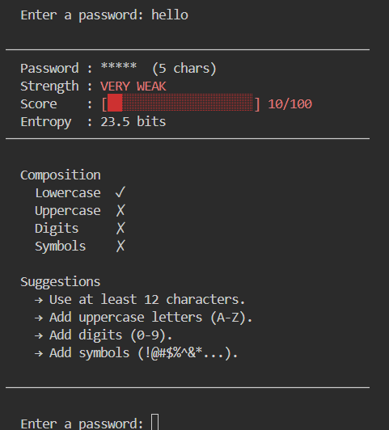

# Password Strength Analyzer
A command-line tool that evaluates password strength using character analysis, entropy calculation and pattern detection.
Built with pure Python without any external dependencies

## Usage
```
python password_analyzer.py
```


## How it works
Passwords are evaluated across three dimensions:
- Length : accounts for up to 40 points. Longer passwords are exponentially harder to brute force regardless of complexity.
- Character diversity : 10 points per character class (lowercase, uppercase, digits, symbols). Using all four classes maximizes the search space an attacker must cover.
- Entropy :  up to 20 bonus points. Calculated as `length × log₂(alphabet_size)`, this gives a mathematically grounded measure of unpredictability. A score above 60 bits is considered strong by current standards.
Pattern detection flags common weaknesses: repeated characters, sequential digits, and keyboard walks (`qwerty`, `azerty`).

## Requirements
Python 3.10+