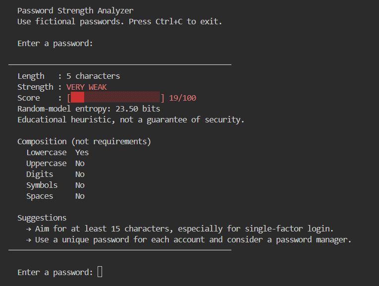
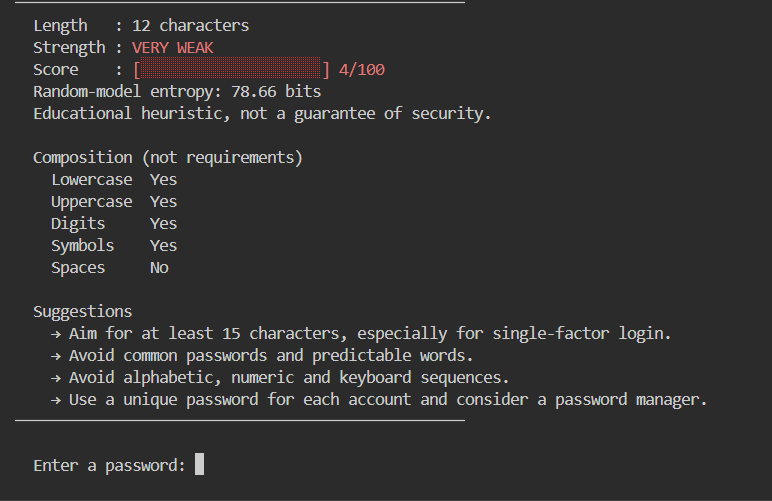
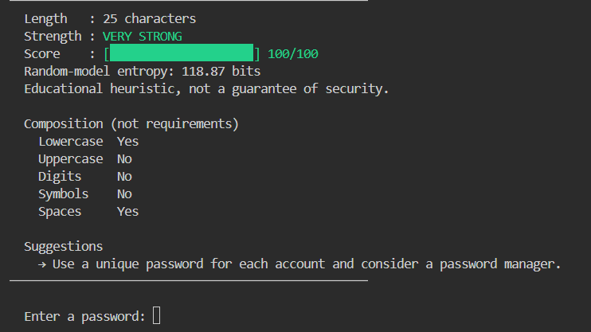
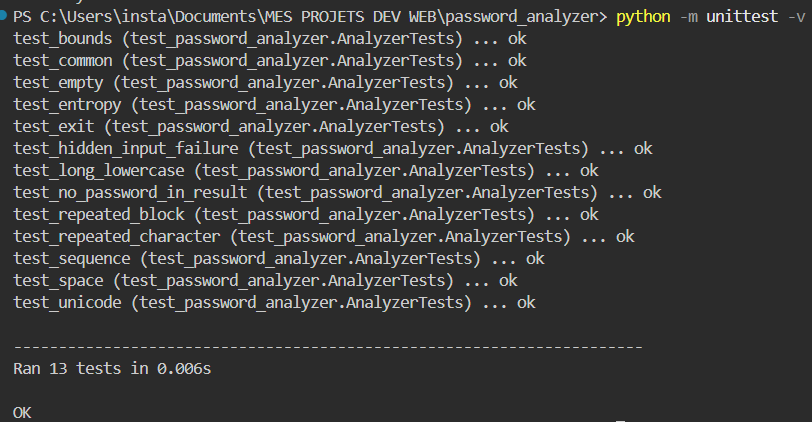

# Password Strength Analyzer

A Python command-line application that analyzes password strength
based on length, character composition and predictable patterns.

## About the Project

I created this project because I wanted to start learning cybersecurity
through small programming projects. Rather than only studying security
concepts in theory, I wanted to apply them through Python.

My goal was to understand what makes a password difficult to guess,
how password strength can be estimated and why a password that looks
complex is not necessarily secure.

Most of the cybersecurity concepts involved in this project were new
to me, which made it a good opportunity to develop both my programming
skills and my understanding of password security.

## Features

- Password strength score from 0 to 100.
- Five different strength levels.
- Password length and character composition analysis.
- Theoretical entropy calculation.
- Common password detection.
- Detection of repeated characters and repeated blocks.
- Detection of alphabetical and numerical sequences.
- QWERTY and AZERTY keyboard pattern detection.
- Unicode character support.
- Hidden password input.
- Password improvement suggestions.
- Colored terminal output with a progress bar.
- Automated unit tests.
- Local processing without external services.

## Technologies Used

I chose to develop this project using Python and its standard library.
I wanted to understand the logic behind password analysis instead of
relying entirely on an existing password-strength library.

| Technology | Purpose |
|---|---|
| Python 3.10+ | Main programming language |
| `re` | Regular expressions and pattern detection |
| `math` | Entropy calculation |
| `string` | Character classification |
| `getpass` | Hidden password input |
| `sys` | Terminal output handling |
| `warnings` | Handling hidden input failures |
| `unittest` | Automated testing |

No external dependencies are required.

## How It Works

When a password is entered, the application:

1. Analyzes its length and character composition.
2. Checks for common passwords and predictable patterns.
3. Calculates its theoretical entropy when supported by the model.
4. Calculates a strength score.
5. Assigns a strength level.
6. Displays the results and suggestions for improvement.

The application processes passwords locally without intentionally
storing them or sending them over the internet.

### Password Strength Scoring

I developed a custom scoring system that gives more importance to
password length than character diversity.

The original version of my project relied heavily on length,
character diversity and entropy. However, this approach could give
a high score to passwords that contained predictable patterns.

I improved the algorithm by introducing penalties and score limits
for detected weaknesses, such as common passwords, repeated
characters and sequential patterns.

| Score | Strength Level |
|---|---|
| 0–19 | Very Weak |
| 20–39 | Weak |
| 40–59 | Moderate |
| 60–79 | Strong |
| 80–100 | Very Strong |

The scoring system is an educational heuristic. It is based on
predefined rules rather than a scientifically validated measurement
of password security.

### Understanding Entropy

One of the main concepts I explored during this project was entropy.

The application uses the following formula:

`H = L × log₂(N)`

Where:

- `H` is the theoretical entropy in bits.
- `L` is the password length.
- `N` is the assumed character pool size.

The formula assumes that each character is selected independently
and uniformly at random.

I learned that a password can have a high theoretical entropy
estimate while still being predictable.

For this reason, I decided to display entropy separately rather
than use it directly in the final strength score.

## Installation

### Requirements

- Python 3.10 or later.
- A terminal that supports hidden password input.

Download or clone the repository and open a terminal inside
the project folder.

There are no additional Python packages to install.

## Usage

Run the following command:

```bash
python password_analyzer.py
```

Enter a fictional password when prompted.

The password will not appear on the screen while typing.
This is intentional and is handled by Python's `getpass` module.

The application will display:

- Password length.
- Strength level and score.
- Theoretical entropy.
- Character composition.
- Suggestions for improving the password.

Multiple passwords can be analyzed without restarting the application.

Press `Ctrl+C` to exit.

## Screenshots

The following screenshots were taken while running the application
on my Windows computer using fictional passwords.

### Weak Password

A short password containing only lowercase letters receives
a score of 19/100.



### Predictable Password

This example demonstrates why character diversity alone is not
enough to make a password secure.

Although the password contains uppercase letters, lowercase letters,
numbers and symbols, the application detects predictable patterns
and gives it a score of 4/100.



### Long Passphrase

This example demonstrates how a longer passphrase can receive
a high score without containing uppercase letters, numbers
or special characters.

The application gives it a score of 100/100 according to its
scoring rules.

However, this does not guarantee that the password is secure.



## Project Structure

```text
password_analyzer/
├── password_analyzer.py
├── test_password_analyzer.py
├── README.md
└── screenshots/
    ├── 01-weak-password.png
    ├── 02-predictable-password.png
    ├── 03-strong-password.png
    └── 04-unit-tests.png
```

- `password_analyzer.py`: Contains the main application, analysis
  functions, scoring system and terminal interface.

- `test_password_analyzer.py`: Contains the automated unit tests
  used to verify the application logic.

- `screenshots/`: Contains screenshots of the application
  and its test results.

I decided to keep the main application in a single Python file
because the project is relatively small. I wanted the structure
to remain simple and easy to understand without introducing
unnecessary complexity.

## Testing

This project also introduced me to automated testing using
Python's built-in `unittest` module.

The tests are stored in a separate file so that the application
logic can be verified without launching the interactive interface.

To run the tests:

```bash
python -m unittest -v
```

The test suite covers:

- Score boundaries.
- Common password detection.
- Empty password analysis.
- Entropy calculation.
- Repeated character detection.
- Repeated block detection.
- Sequential pattern detection.
- Long lowercase passwords.
- Unicode character classification.
- Space handling.
- Password privacy in returned results.
- Application exit.
- Hidden input failure handling.

All 13 automated tests passed on my Windows environment
using Python 3.10.



## Security and Privacy

Since this project involves passwords, I wanted to understand
how to handle potentially sensitive information responsibly.

I replaced Python's standard `input()` function with `getpass()`
because I did not want passwords to be displayed while typing.

The application also stops if hidden input is unavailable
instead of falling back to visible input.

Passwords are not intentionally:

- Written to a file.
- Stored in a database.
- Sent to an external API.
- Included in the returned analysis results.

However, Python does not guarantee that deleting a variable
securely removes its contents from memory.

## Challenges and Improvements

One of the main limitations of the original version was its
scoring algorithm.

A password could receive a high score simply because it contained
different character types, even if it followed an obvious pattern.

This helped me understand the difference between password
complexity and predictability.

The main improvements made during the project review were:

- Giving more importance to password length.
- Including predictable patterns in the scoring system.
- Improving common password detection.
- Supporting Unicode characters.
- Introducing hidden password input.
- Separating analysis from terminal output.
- Improving error handling.
- Adding automated unit tests.

I also encountered an `ImportError` when running the tests
because my local application file was incomplete.

To investigate the error, I checked which Python file was being
imported and which functions were available inside it. This
allowed me to identify the missing functions and resolve
the problem.

It was a useful introduction to debugging Python modules
and understanding error messages.

## What I Learned

Most of the concepts involved in this project were new to me.

Through developing and reviewing this application, I learned
about:

### Programming

- Python functions and dictionaries.
- Regular expressions.
- String manipulation.
- Type annotations.
- Unicode characters.
- Exception handling.
- Separation of concerns.
- Automated unit testing.
- Debugging import errors.

### Cybersecurity

- Password security fundamentals.
- Password complexity and predictability.
- The mathematical concept of entropy.
- Common password weaknesses.
- Pattern recognition.
- Sensitive data handling.
- Password privacy.
- Limitations of password-strength estimation.

This project helped me understand that cybersecurity is not
only about using security tools. It also involves understanding
how those tools work, what assumptions they make and where
their limitations are.

I still have more to learn about password security and
strength-estimation algorithms, but this project gave me
a practical starting point.

## Limitations

This application is an educational project, not a professional
password auditing tool.

Its current limitations include:

- A small and incomplete common-password list.
- Custom scoring thresholds.
- Limited recognition of predictable words and patterns.
- An entropy model restricted to ASCII characters.
- No checking against compromised-password databases.
- No guarantee that a highly rated password is secure.
- Limited cross-platform testing.

I chose to keep the scope manageable so I could focus on
understanding the main concepts before exploring more
advanced approaches.

## Future Improvements

As I continue learning cybersecurity and Python, I would
like to explore:

- Larger common-password lists.
- More advanced pattern detection.
- Secure password generation using Python's `secrets` module.
- Random passphrase generation.
- Privacy-preserving compromised-password checking.
- Established password-strength estimation algorithms.
- Additional automated tests.
- Continuous integration with GitHub Actions.

## Resources

Some useful resources for understanding the concepts
covered in this project:

- [NIST — Authentication and Authenticator Management](https://pages.nist.gov/800-63-4/sp800-63b.html)
- [Python — Regular Expressions](https://docs.python.org/3/library/re.html)
- [Python — getpass](https://docs.python.org/3/library/getpass.html)
- [Python — unittest](https://docs.python.org/3/library/unittest.html)
- [Python — Mathematical Functions](https://docs.python.org/3/library/math.html)